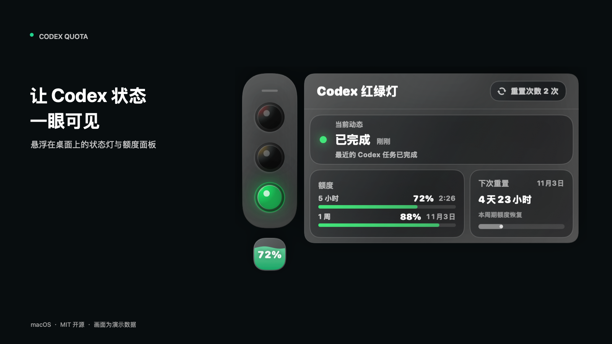
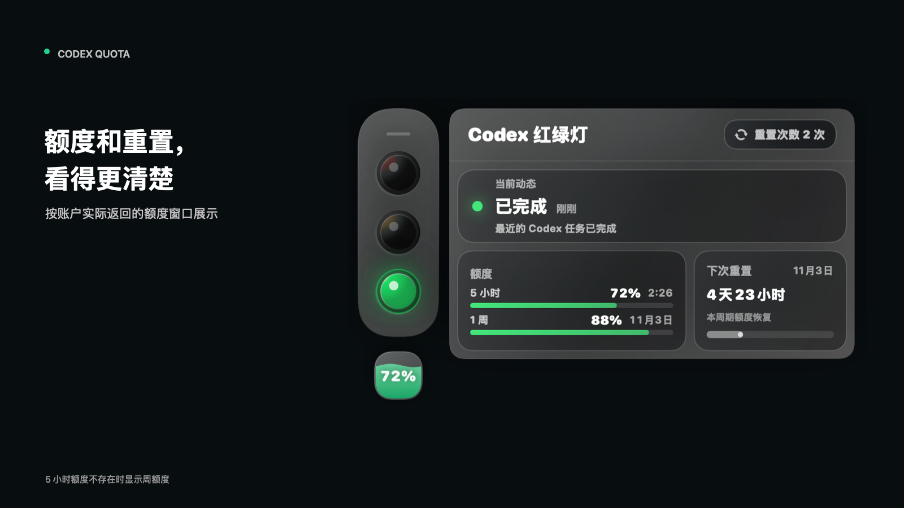

# Codex Quota

**让 Codex 的任务状态和额度，一眼可见。**

Codex Quota 是一款 macOS 桌面悬浮工具，用红绿灯和展开面板展示 Codex 的近期任务状态、可用额度和重置时间。



> 图片和视频使用虚构演示数据，界面由实际应用代码渲染。状态根据本地会话记录推断，可能受数据更新或读取情况影响。

[观看 22 秒介绍视频](docs/media/intro.mp4) · [查看演示界面](docs/media/demo.png) · [历史版本下载](https://github.com/LeeYH95/codex-status-light/releases)

## 它能做什么

- **红绿灯看动态**：执行中、思考中、等待确认、完成或失败等状态一目了然。
- **展开查看额度**：按账户返回的数据展示 5 小时和每周剩余额度、重置时间；没有 5 小时窗口时显示周额度。
- **查看重置次数**：有可用重置卡时显示数量，并可查看到期时间。
- **留在桌面上**：悬浮窗可拖动，鼠标移入展开详情，离开后自动收起；下方额度球在有 5 小时额度时优先显示它，否则显示周额度。



## 开始使用

需要 macOS 14 或更新版本、Swift 6 工具链和可用的 Codex 本地环境。当前仓库代码对应 v1.0.9；[Releases](https://github.com/LeeYH95/codex-status-light/releases) 中现有最新安装包为 **v1.0.1**，不包含后续所有功能。若要使用当前源码，请克隆后运行：

```sh
git clone https://github.com/LeeYH95/codex-status-light.git
cd codex-status-light
swift run --disable-sandbox Codexquota
```

首次构建需要可用的 Xcode / Swift 开发环境。现有安装包的公证状态未在本次宣传制作中验证；请根据自己的安全策略检查来源和系统提示。

## 数据与限制

应用读取本机 `~/.codex/sessions` 中近期会话日志，并通过本机 Codex app-server 获取账户额度；读取失败或数据尚未更新时，显示可能延迟或不可用。额度窗口和重置卡取决于账户实际返回的数据，不能保证每个套餐都有这些项目。Codex 程序可能与其服务通信，应用并非 Codex 官方产品。

## 构建与参与

```sh
swift run --disable-sandbox CodexTrafficGlassSelfTests
swift build --disable-sandbox
```

欢迎通过 GitHub Issues 反馈问题。版本号记录在 `VERSION`，正式发行说明和发布流程见 [CHANGELOG](CHANGELOG.md) 与 [打包脚本](scripts/package-release.sh)。宣传素材与依据见 [素材清单](launch-manifest.json) 和 [视频分镜](docs/launch/storyboard.md)。

## 许可证

本项目使用 [MIT License](LICENSE)。
